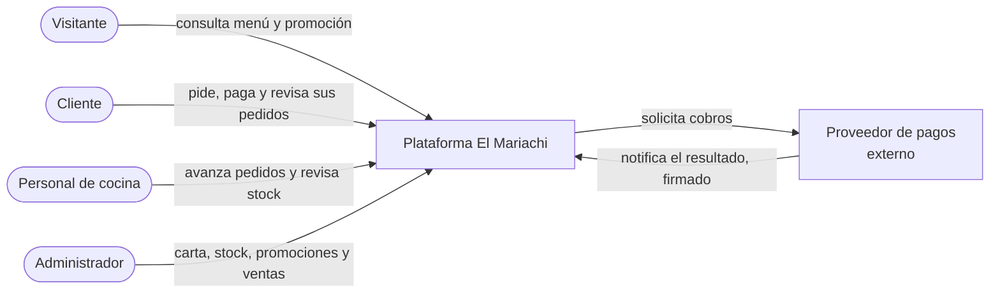
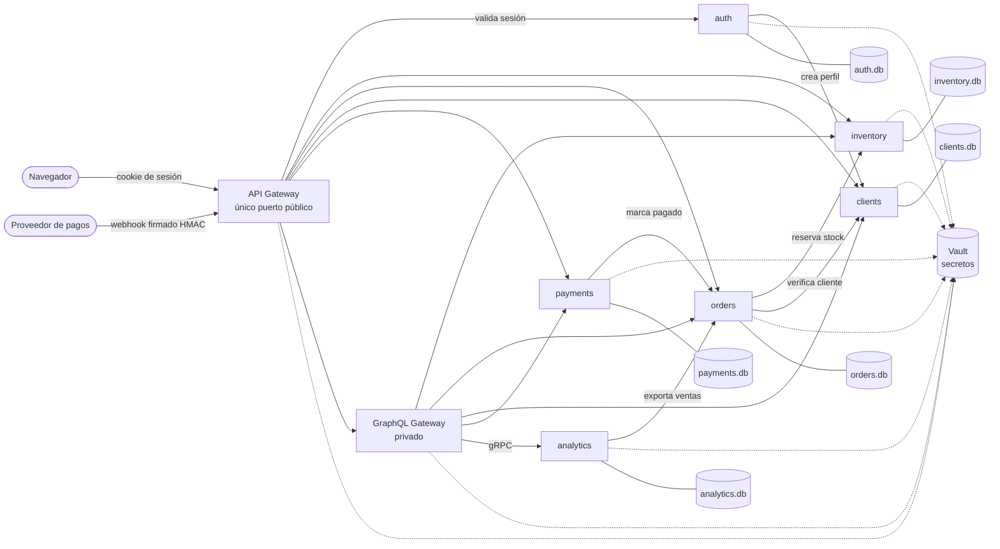

# El Mariachi — Backend seguro

**Informe de la Evaluación de la Unidad 2** · Desarrollo Web y Móvil (DWM2026) · Diseño e implementación de un backend seguro completo

| | |
|---|---|
| Caso | El Mariachi, restaurante de comida mexicana (tacos, burritos, nachos y otros). Número en el listado de casos: **por completar** |
| Integrantes | Benjamín Guzmán · Matías Cañete |
| Frontend de referencia | Evaluación 1: Inicio (con Pedido Rápido), Menú, Detalle, Pedido, Confirmación, Nosotros y Contacto; 12 platillos en 5 categorías |
| Entrega | 09-11-2026 |

> **Alcance confirmado por el docente**
> - La evaluación es *con datos de frontend*, no con el frontend integrado: cada servicio se prueba con los mismos datos que usa el frontend (platillos, promoción, formulario y carrito).
> - **Basta con ejecutar en local.** Docker es opcional, siempre que se entregue el `docker-compose.yml` para replicar: está en [`docker-compose.yml`](docker-compose.yml).
> - Un README bien armado que referencie y explique el código vale como informe. Este README es el informe. El detalle completo, con todas las matrices, está en [`docs/INFORME.md`](docs/INFORME.md).

## Resultados en una mirada

| Qué | Resultado | Evidencia |
|---|---|---|
| Pruebas automatizadas | **136 pruebas, 0 fallas** | [`docs/evidencia/pytest.xml`](docs/evidencia/pytest.xml) |
| Fallas introducidas a propósito y detectadas | **10 de 10** | [`docs/evidencia/mutaciones.json`](docs/evidencia/mutaciones.json) |
| Recorrido de punta a punta | **17 de 17** verificaciones | [`docs/evidencia/smoke_e2e.txt`](docs/evidencia/smoke_e2e.txt) |
| Ejecuciones reales citadas en el informe | 38 registros (solicitud y respuesta) | [`docs/evidencia/ejecuciones.json`](docs/evidencia/ejecuciones.json) |
| Exportar 100.000 ventas | gRPC 3,3 veces más rápido que REST y con 0,52 veces los bytes | [`bench/results.json`](bench/results.json) |

## Contenido

- [Ejecutar en local](#ejecutar-en-local)
- [Arquitectura](#arquitectura)
- [Módulo 1 · Servicios derivados del frontend](#módulo-1--servicios-derivados-del-frontend)
- [Módulo 2 · Clases y cardinalidades del dominio](#módulo-2--clases-y-cardinalidades-del-dominio)
- [Módulo 3 · Sistemas e integraciones](#módulo-3--sistemas-e-integraciones)
- [Módulo 4 · Stakeholders y permisos HTTP](#módulo-4--stakeholders-y-permisos-http)
- [Módulo 5 · Clases del API Gateway](#módulo-5--clases-del-api-gateway)
- [Módulo 6 · Rutas y secretos de integración](#módulo-6--rutas-y-secretos-de-integración)
- [Módulo 7 · Datos sensibles y secretos del cliente](#módulo-7--datos-sensibles-y-secretos-del-cliente)
- [Módulo 8 · Separación privada y agregaciones GraphQL](#módulo-8--separación-privada-y-agregaciones-graphql)
- [Módulo 9 · Analítica y comunicación gRPC](#módulo-9--analítica-y-comunicación-grpc)
- [Módulo 10 · Backend completo y pruebas](#módulo-10--backend-completo-y-pruebas)
- [Mapa del código](#mapa-del-código)
- [Limitaciones](#limitaciones)

---

## Ejecutar en local

Requisitos: Python 3.12 o superior. No se necesita Docker ni instalar Vault.

```bash
pip install -r requirements-dev.txt
python -m scripts.run_local
```

Levanta los 8 servicios y un Vault de desarrollo en memoria ([`tools/dev_vault.py`](tools/dev_vault.py)) en un solo proceso. Cada servicio tiene su propia base SQLite con datos de prueba. Al arrancar muestra:

```text
Sistema local levantado (Vault de desarrollo en memoria, un solo proceso)
Gateway: http://127.0.0.1:8000
Servicios privados (deben responder 403 si se llaman directo): auth http://127.0.0.1:20243, ..., orders http://127.0.0.1:28844, ...
Vault: http://127.0.0.1:28683 token raiz: <generado al azar>
Usuarios: camila, matias (customer), cocina (kitchen), benjamin (admin). Clave: <generada al azar>
Ctrl+C para detener
```

El puerto del gateway se puede cambiar con la variable `GATEWAY_PORT`. Los tokens y claves se generan en cada arranque; no hay ninguno escrito en el código.

### Probar con los datos del frontend

En otra terminal (en Windows PowerShell usen `curl.exe` en vez de `curl`):

```bash
G=http://127.0.0.1:8000
curl -s $G/products                  # P02 Menú: los 12 platillos del frontend, sin sesión
curl -s $G/promotions                # P01 Inicio: «PROMOCIÓN DEL DÍA: 2x1 en Tacos al Pastor»

curl -s -c sesion.txt -H 'Content-Type: application/json' \
  -d '{"username":"camila","password":"<clave que mostró run_local>"}' $G/auth/login

curl -s -b sesion.txt -X PATCH -H 'Content-Type: application/json' \
  -d '{"name":"Camila Rojas","phone":"9 1111 1111"}' $G/clients/CLI-001
# P03 contacto → "phone":"+56911111111" (normalizado por el servidor)

curl -s -b sesion.txt -H 'Content-Type: application/json' \
  -d '{"items":[{"product_id":1,"qty":2},{"product_id":11,"qty":1}],"notes":"sin cebolla"}' $G/orders
# P03 carrito → "subtotal":8200, "discount":2500, "total":5700, "status":"pendiente_pago"

curl -s -b sesion.txt -H 'Content-Type: application/json' \
  -d '{"query":"query($id: String!){ order(id:$id){ id createdAt total client{ name phone } items{ qty name unitPrice discount } } }","variables":{"id":"<id del pedido>"}}' $G/graphql
# P04 Confirmación en una sola consulta

curl -s $G/orders                    # sin sesión → 401
curl -s http://127.0.0.1:<puerto de orders>/orders   # servicio privado llamado directo → 403 «Llamador no autorizado»
```

La última línea muestra la **separación pública y privada en local**: un servicio privado rechaza cualquier llamada que no traiga el secreto de su integración, aunque esté en la misma máquina. Con Docker se suma el aislamiento de red.

### Pruebas

```bash
python -m pytest tests -q                  # 136 pruebas, levantan los servicios reales en procesos
python docs/evidencia/mutaciones.py        # introduce 10 fallas y verifica que las pruebas las detectan
python -m bench.load_test 100000           # prueba de carga REST contra gRPC
```

### Docker (opcional)

```bash
cp .env.example .env          # completar VAULT_ROOT_TOKEN y DEMO_PASSWORD con valores propios
docker compose up --build     # Vault, generación de secretos y los 8 servicios
docker compose ps             # health checks
docker compose down -v        # detiene y borra datos y tokens
```

Solo el API Gateway publica un puerto (`127.0.0.1:8000`); el resto queda en la red `private` con `internal: true`. El archivo `.env` no se versiona.

---

## Arquitectura

**Contexto (nivel 1).** Quién usa el sistema y con qué sistema externo se comunica.



**Contenedores (nivel 2).** Las líneas punteadas son lecturas de secretos: cada servicio tiene su propio token de Vault.



Principios del diseño:

- **Una sola puerta pública.** El API Gateway decide qué rutas existen; lo que no está en [`routes.py`](services/api_gateway/routes.py) responde 404 o 405.
- **Un secreto por integración.** Cada flecha entre servicios usa su propio secreto en Vault (`mariachi/edges/<destino>/<llamador>`). La topología permitida está en [`common/topology.py`](common/topology.py) y la verifica cada servicio en [`common/security.py`](common/security.py).
- **Una base por servicio.** Ningún servicio lee la base de otro; colaboran por contratos.
- **El servidor decide.** Precio, descuento 2x1, total, stock, estado del pedido y estado del pago nunca vienen del navegador.

---

## Módulo 1 · Servicios derivados del frontend

Los servicios salen de las acciones de cada pantalla del frontend. Lo que no tiene pantalla se declara como brecha, pero el servicio existe y está probado.

| Pantalla | Acción en el frontend | Servicios |
|---|---|---|
| P01 Inicio | Ver la promoción del día | S34 |
| P02 Menú | Cargar platillos, filtrar por categoría (Tacos, Burritos, Nachos, Bebidas, Otros) | S04 |
| P02b Detalle | Ver un platillo, su promoción y elegir cantidad | S05, S34 |
| P03 Pedido | Datos de contacto, carrito con notas, confirmar | S14, S15 |
| P04 Confirmación | Número, fecha, cliente, ítems y total | S30 (`order`) |
| P05 Nosotros, P05b Contacto | Texto institucional, dirección, mapa y WhatsApp | — |
| P06–P10 (sin pantalla) | Registro e ingreso, pago, mis pedidos, cocina, administración | S01–S03, S33, S16–S26, S06–S13, S35 |

Catálogo de servicios (todos pasan por el API Gateway):

| ID | Operación | Verbo y ruta | Quién |
|---|---|---|---|
| S01 | Registrarse | `POST /auth/register` | anónimo |
| S02 | Iniciar sesión | `POST /auth/login` | anónimo |
| S03 | Cerrar sesión | `POST /auth/logout` | autenticado |
| S33 | Identidad actual | `GET /auth/me` | autenticado |
| S04 | Ver menú | `GET /products` | anónimo |
| S05 | Ver un platillo | `GET /products/{id}` | anónimo |
| S34 | Ver promociones | `GET /promotions` | anónimo |
| S35 | Activar o desactivar promoción | `PATCH /promotions/{id}` | admin |
| S06 | Crear platillo | `POST /products` | admin |
| S07 | Editar platillo | `PATCH /products/{id}` | admin |
| S08 | Dar de baja platillo (lógica) | `DELETE /products/{id}` | admin |
| S09 | Ver stock | `GET /stock` | cocina, admin |
| S10 | Ajustar stock | `POST /stock/{id}/adjust` | cocina, admin |
| S11 | Listar clientes | `GET /clients` | admin |
| S12 | Ver un cliente | `GET /clients/{id}` | dueño o admin (cocina: solo id y nombre) |
| S13 | Crear cliente | `POST /clients` | admin |
| S14 | Actualizar contacto | `PATCH /clients/{id}` | dueño, admin |
| S15 | Crear pedido | `POST /orders` | cliente |
| S16 | Listar pedidos | `GET /orders` | autenticado (alcance según rol) |
| S17 | Ver un pedido | `GET /orders/{id}` | dueño, cocina, admin |
| S18 | Anular pedido | `POST /orders/{id}/cancel` | dueño (pendiente), admin |
| S19 | Avanzar estado | `PATCH /orders/{id}/status` | cocina, admin |
| S20 | Expirar pedidos sin pago | `POST /orders/expire-pending` | admin |
| S21 | Recuperar stock pendiente | `POST /orders/reconcile-stock` | admin |
| S22 | Iniciar pago | `POST /payments` | cliente |
| S23 | Aviso del proveedor | `POST /payments/webhook` | proveedor (firma HMAC) |
| S24 | Ver un pago | `GET /payments/{id}` | dueño, admin |
| S25 | Listar pagos | `GET /payments` | dueño, admin |
| S26 | Conciliar pagos | `POST /payments/reconcile` | admin |
| S27–S29 | Sincronizar, resumir y exportar ventas | gRPC `Sync`, `SalesSummary`, `StreamSales` | admin, vía GraphQL |
| S30–S32 | Consultas y mutaciones GraphQL | `POST /graphql` | según operación y campo |

Brechas declaradas:

- **B1 (resuelta):** la promoción 2x1 era solo texto; ahora la publica y la aplica el servidor.
- **B2:** no existen las pantallas P06 a P10.
- **B3:** el frontend genera su propio número de orden y calcula su total (ya aplica el 2x1 con la misma regla); el total oficial es el del servidor.
- **B4:** despacho, boletas y mensajería. Despacho no aplica porque el formulario no pide dirección (retiro en el local); boletas y mensajería quedan fuera de alcance.

Contratos con ejemplos reales y la tabla completa con entradas, salidas y errores: [informe, módulo 1](docs/INFORME.md#módulo-1--servicios-derivados-del-frontend).

## Módulo 2 · Clases y cardinalidades del dominio


Editable en draw.io: [`docs/diagramas/uml_dominio.drawio`](docs/diagramas/uml_dominio.drawio).

- Cliente 1 — 0..\* Pedido; Pedido 1 — 1..\* DetallePedido (un pedido confirmado tiene al menos un ítem).
- Producto 1 — 1 Stock (`0 ≤ reservado ≤ en mano`); Producto 1 — 0..1 Promoción.
- Pedido 1 — 0..\* Pago (solo uno vigente); Pago 1 — 0..\* EventoWebhook (único por `event_id`).
- El carrito vive en el navegador y el pedido nace al confirmar. El detalle copia nombre, precio y descuento, así que si el producto cambia o se da de baja, el historial no cambia.
- Los datos internos (hash de clave, claves de idempotencia, banderas de recuperación) nunca salen en las respuestas; existencias solo para cocina y administración.

Reglas de cada relación y tabla modelo/DTO: [informe, módulo 2](docs/INFORME.md#módulo-2--clases-y-cardinalidades-del-dominio).

## Módulo 3 · Sistemas e integraciones


| Sistema | Decide | Datos propios | Si una dependencia falla |
|---|---|---|---|
| inventory | Disponibilidad, precio y descuento vigente | productos, stock, promociones, reservas | Reserva atómica: nunca vende de más |
| orders | Estado oficial del pedido | pedidos, detalle, eventos | No crea el pedido ni deja reservas (502/503); recupera stock pendiente |
| clients | Qué ve cada actor de un cliente | perfiles | 404 al que no es dueño |
| payments | Estado del pago; único que marca un pedido pagado | pagos, avisos | Queda pagado sin sincronizar y se reintenta o concilia |
| auth | Identidad y sesión | usuarios, sesiones | Registro con compensación si `clients` falla |
| analytics | Reportes de venta | hechos de venta | GraphQL devuelve error parcial en ese campo |


Matriz completa de sistemas y contratos: [informe, módulo 3](docs/INFORME.md#módulo-3--sistemas-e-integraciones).

## Módulo 4 · Stakeholders y permisos HTTP

| Stakeholder | Rol | Puede |
|---|---|---|
| Visitante | anónimo | Ver menú y promociones |
| Cliente (Camila, Matías) | `customer` | Sus datos, sus pedidos y sus pagos |
| Personal de cocina | `kitchen` | Pedidos pagados, nombre del cliente, stock; sin correo, teléfono ni pagos |
| Administrador (Benjamín) | `admin` | Todo el negocio |
| Proveedor de pagos | firma HMAC | Solo el webhook |
| Servicios internos | identidades técnicas | Solo las integraciones permitidas |
| Redes sociales, contabilidad, docentes | **sin permisos operativos** | Reciben información por otros medios |

| Ruta | Visitante | Cliente | Cocina | Admin |
|---|---|---|---|---|
| `GET /products`, `GET /promotions` | ✔ | ✔ | ✔ + stock | ✔ + stock |
| Escribir productos, promociones, `GET/POST /clients` | 401 | 403 | 403 | ✔ |
| `GET /stock`, ajustar stock | 401 | 403 | ✔ | ✔ |
| `POST /orders` | 401 | ✔ | 403 | 403 |
| `GET /orders/{id}` | 401 | solo propio (ajeno → 404) | ✔ | ✔ |
| `PATCH /orders/{id}/status` | 401 | 403 | ✔ | ✔ |
| `POST /payments` | 401 | solo pedidos propios | 403 | 403 |
| `PUT` en cualquier ruta | 405 | 405 | 405 | 405 |
| Rutas internas (`/internal/*`, `/reservations`) | 404 | 404 | 404 | 404 |

Ocultar un botón no da ni quita permisos: todas estas decisiones las toma el backend, y la prueba [`test_matriz_de_permisos_http`](tests/test_security.py) recorre la matriz. Matriz completa con condiciones y dónde se verifica cada una: [informe, módulo 4](docs/INFORME.md#módulo-4--stakeholders-y-permisos-http).

## Módulo 5 · Clases del API Gateway


- **Dos gateways con funciones distintas.** Un API Gateway externo (puerta pública, sesión, roles, límites) y un GraphQL Gateway privado (agregación de lectura con permisos por campo).
- **API Gateway** ([`main.py`](services/api_gateway/main.py)):
  - valida la ruta y el verbo, la sesión (pregunta a `auth` en cada solicitud), el rol, el límite de tasa, el tamaño del cuerpo (64 KiB) y que sea JSON;
  - borra las cabeceras de identidad que mande el navegador;
  - espera hasta 3 segundos a cada servicio.
- **Servicios privados:** vuelven a comprobar al llamador, el rol, la propiedad del recurso y las reglas de negocio.
- **Errores controlados:** 401, 403, 404, 405, 413, 415, 429, 502, 503 y 504. Si Vault no responde, el sistema falla cerrado.


Detalle: [informe, módulo 5](docs/INFORME.md#módulo-5--clases-del-api-gateway).

## Módulo 6 · Rutas y secretos de integración

Rutas: [`services/api_gateway/routes.py`](services/api_gateway/routes.py) es la matriz de rutas ejecutable; el informe la genera desde ese archivo. Contratos: GraphQL en [`docs/schema.graphql`](docs/schema.graphql) y gRPC en [`analytics.proto`](services/analytics/analytics.proto).

| Referencia en Vault | Para qué | Quién la lee |
|---|---|---|
| `mariachi/edges/<destino>/<llamador>` (16) | Autenticar cada integración entre servicios | Solo el llamador y el destino de esa integración |
| `mariachi/payments` | Verificar con HMAC los avisos del proveedor | Solo `payments` |
| Token de Vault por servicio | Leer solo sus propios secretos | Cada servicio, montado de solo lectura |

Rotar y revocar, por ejemplo si un secreto se filtra ([`scripts/vault_bootstrap.py`](scripts/vault_bootstrap.py)):

```bash
python scripts/vault_bootstrap.py --token-dir /tokens --rotate-edge orders inventory           # nuevo secreto; el anterior sigue sirviendo
python scripts/vault_bootstrap.py --token-dir /tokens --revoke-previous-edge orders inventory  # invalida el anterior
python scripts/vault_bootstrap.py --token-dir /tokens --rotate-webhook
python scripts/vault_bootstrap.py --token-dir /tokens --revoke-previous-webhook
```

Necesitan las variables `VAULT_ADDR` y `VAULT_ROOT_TOKEN` (en local, las que muestra `run_local`). Con Docker se ejecutan con `docker compose run --rm vault-bootstrap` antes del comando. Pruebas: `test_rotacion_con_gracia_y_revocacion`, `test_vault_minimo_privilegio_por_servicio` y `test_vault_caido_falla_cerrado`. Matriz completa de rutas e inventario de secretos: [informe, módulo 6](docs/INFORME.md#módulo-6--rutas-y-secretos-de-integración).

## Módulo 7 · Datos sensibles y secretos del cliente

| Dato | Clasificación | Protección |
|---|---|---|
| Menú y precios | Público | Solo admin escribe |
| Nombre, correo y teléfono | Personal restringido | Solo dueño y admin (cocina ve solo el nombre); fuera de los logs |
| Contraseña | Credencial | scrypt con sal; nunca se devuelve ni se registra |
| Sesión | Credencial | Cookie HttpOnly opaca de 15 minutos; el servidor guarda solo el hash |
| Pedidos y pagos | Restringido | Propiedad por `client_id`; un pedido ajeno responde 404 |
| Datos de tarjeta | No se manejan | El cobro lo hace el proveedor |

**No se custodian secretos del cliente** fuera del hash de su contraseña. El navegador no recibe ninguna clave compartida, solo la cookie de sesión.

Casos ejecutados (respuestas reales en [`ejecuciones.json`](docs/evidencia/ejecuciones.json)):

| Caso | Qué se intentó | Resultado |
|---|---|---|
| V2 | Ver pedidos sin sesión | 401 |
| V3 | Cliente crea un producto | 403 |
| V4c | Matías consulta el pedido de Camila | 404 sin datos |
| V5a / V5b | Llamar directo a un servicio privado, sin secreto o con el de otra integración | 403 |
| V5c | Cliente inventa cabeceras `X-Roles: admin` | 403 |
| V6b / V6c | Confirmar un pago con firma falsa o monto alterado | 401 / 409 |
| V6d / V6e | Cliente intenta marcar su pedido pagado | 403 / 404 |
| V7b | Aviso de pago duplicado | 200 sin volver a cobrar |
| F4 | Teléfono inválido según la regla del formulario | 422 |

Detalle y recorrido del correo de punta a punta: [informe, módulo 7](docs/INFORME.md#módulo-7--datos-sensibles-y-secretos-del-cliente).

## Módulo 8 · Separación privada y agregaciones GraphQL

Cada servicio tiene una responsabilidad y datos propios ([mapa de clasificación](docs/INFORME.md#81-mapa-de-clasificación)). El GraphQL Gateway ([`services/graphql_gateway/`](services/graphql_gateway/)) no tiene base de datos: compone lecturas de cuatro servicios.

| Control | Valor |
|---|---|
| Profundidad máxima | 6 |
| Costo máximo | 5000 (una consulta abusiva da «7206 excede el máximo 5000») |
| Página | de 1 a 50 elementos, con cursor |
| Introspección | Apagada |
| N+1 | DataLoaders: una llamada por servicio en cada consulta |
| Errores | Parciales por campo; si `clients` cae, el pedido igual llega con `client: null` |

| Campo | Cliente | Cocina | Admin |
|---|---|---|---|
| Pedidos | solo propios | pagados, en preparación y listos | todos |
| `client.email`, `client.phone` | propio | ✘ | ✔ |
| `payment` | propio | ✘ | ✔ |
| `product.stock` | ✘ | ✔ | ✔ |
| `salesSummary` | ✘ | ✘ | ✔ |

Esquema, consulta de prueba con su respuesta real y evidencia G1–G10: [informe, módulo 8](docs/INFORME.md#módulo-8--separación-privada-y-agregaciones-graphql).

## Módulo 9 · Analítica y comunicación gRPC

**Decisión (ADR-001).**
- La analítica va en un servicio privado separado de las transacciones. Se alimenta por sincronización incremental desde `orders`, idempotente.
- Usa gRPC ([`analytics.proto`](services/analytics/analytics.proto)) para tres operaciones: `Sync`, `SalesSummary` y `StreamSales`. Esta última es streaming por lotes y se puede reanudar.
- Con el volumen actual del local (estimado en cientos de pedidos al día) bastaría SQL. La decisión se justifica por la exportación masiva, según esta medición:

| Exportar 100.000 ventas | Tiempo | Filas por segundo | Bytes | CPU del servidor |
|---|---|---|---|---|
| REST/JSON paginado | 1,37 s | 73.154 | 11,5 MB | 1,13 s |
| gRPC streaming (lotes de 2000) | 0,41 s | 241.310 | 6,0 MB | 0,36 s |

En el resumen de ventas (una consulta), REST y gRPC rinden igual: alrededor de 25 solicitudes por segundo, porque el tiempo lo pone la consulta SQL y no el protocolo. Entorno: 2 CPU, 8 GB, Python 3.13. Se reproduce con `python -m bench.load_test 100000`. ADR completo y alternativas descartadas: [informe, módulo 9](docs/INFORME.md#módulo-9--analítica-y-comunicación-grpc).

## Módulo 10 · Backend completo y pruebas

- **Persistencia real.** Cada servicio tiene su SQLite con esquema y restricciones ([ejemplo](services/orders/schema.sql)). Los datos persisten al reiniciar y la siembra es reproducible.
- **Datos de prueba ficticios:**
  - los 12 platillos del frontend con sus mismos ids, nombres, categorías y precios (por ejemplo 1 Tacos al Pastor $2.500, 4 Burrito Especial $4.500, 9 Agua de Horchata $1.800, 11 Quesadilla Mixta $3.200);
  - la promoción 2x1;
  - los clientes CLI-001 y CLI-002;
  - los usuarios `camila`, `matias`, `cocina` y `benjamin`.
- **Logs** en JSON con `request_id` en todos los servicios, sin secretos ni datos personales. En una búsqueda de 10 secretos reales en 349 líneas de log hubo 0 coincidencias.
- **Pruebas** ([`tests/`](tests/)): de contratos, integración, reglas de negocio y seguridad, contra los servicios levantados de verdad.

| Archivo | Qué prueba |
|---|---|
| [`test_frontend_flujos.py`](tests/test_frontend_flujos.py) | Datos del frontend: catálogo idéntico, promoción, formulario, carrito y confirmación |
| [`test_security.py`](tests/test_security.py) | Matriz de permisos, propiedad, acceso directo, cabeceras falsas, Vault caído y rotación |
| [`test_orders_stock.py`](tests/test_orders_stock.py) | Stock, 10 compras simultáneas sin sobreventa, idempotencia, estados y recuperación |
| [`test_payments.py`](tests/test_payments.py) | Firma, monto, avisos duplicados (también en paralelo) y conciliación |
| [`test_graphql.py`](tests/test_graphql.py) | Agregación, N+1, permisos por campo, límites y errores parciales |
| [`test_analytics_grpc.py`](tests/test_analytics_grpc.py) | Autorización gRPC, sincronización idempotente y streaming |
| [`test_registro.py`](tests/test_registro.py) | Registro, validaciones, duplicados y compensación |
| [`test_contracts.py`](tests/test_contracts.py), [`test_observability.py`](tests/test_observability.py) | Contratos, health y ready, logs, persistencia |

**Las pruebas detectan defectos.** [`mutaciones.py`](docs/evidencia/mutaciones.py) mete 10 fallas a propósito y todas hicieron fallar su prueba. Algunas de esas fallas: quitar el control de dueño, quitar la deduplicación de avisos, vender sin stock, abrir una ruta de admin y desactivar el 2x1.

Matriz requisito · pantalla · servicio · prueba · resultado, y demostración con datos del frontend: [informe, módulo 10](docs/INFORME.md#módulo-10--backend-completo-e-integración-verificable).

---

## Mapa del código

| Ruta | Qué hace |
|---|---|
| [`services/api_gateway/`](services/api_gateway/) | Puerta pública: rutas, sesión, roles, límites, proxy |
| [`services/auth/`](services/auth/) | Registro, ingreso, sesiones, bloqueo por intentos |
| [`services/inventory/`](services/inventory/) | Catálogo, promociones, stock y reservas |
| [`services/orders/`](services/orders/) | Pedidos, estados, expiración y recuperación de stock |
| [`services/clients/`](services/clients/) | Perfiles y datos personales |
| [`services/payments/`](services/payments/) | Pagos, webhook HMAC, deduplicación y conciliación |
| [`services/graphql_gateway/`](services/graphql_gateway/) | Schema, resolvers, DataLoaders, permisos y límites |
| [`services/analytics/`](services/analytics/) | Servidor y cliente gRPC, contrato `.proto` |
| [`common/`](common/) | Guardia de llamador, cliente entre servicios, Vault, logs, validaciones |
| [`scripts/`](scripts/) | Arranque local, generación y rotación de secretos, recorrido de punta a punta |
| [`tools/dev_vault.py`](tools/dev_vault.py) | Vault de desarrollo para local y pruebas |
| [`tests/`](tests/) · [`bench/`](bench/) | Pruebas y prueba de carga |
| [`docs/`](docs/) | Informe, diagramas, esquema GraphQL y evidencias |

## Limitaciones

- **Vault de desarrollo.** En local se usa uno en memoria que respeta políticas y tokens por servicio. En el compose se usa Vault en modo desarrollo. En producción correspondería modo servidor con TLS y almacenamiento persistente.
- **Docker opcional.** El `docker-compose.yml` se entrega para replicar; su sintaxis se validó, pero no se pudo ejecutar en el entorno de desarrollo (sin acceso a las imágenes).
- **Sin TLS interno.** No hay TLS entre servicios; gRPC va sin cifrar dentro de la red privada.
- **Proveedor de pagos simulado.** Usa el mismo contrato que uno real: firma y eventos.
- **Funciones no implementadas.** Borrado o anonimización de cuentas, y un límite de tasa compartido entre varias instancias del gateway.

Detalle y justificación de cada punto: [informe, limitaciones](docs/INFORME.md#limitaciones-y-trabajo-pendiente-declaradas).
